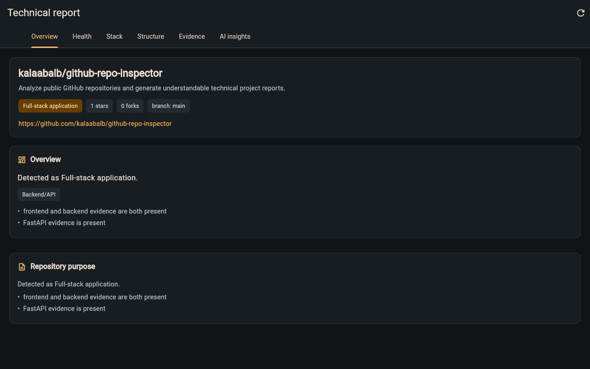

# GitHub Repository Inspector

An AI-powered developer tool that will turn a public GitHub repository into an understandable technical report.

[](https://github.com/kalaabalb/github-repo-inspector/actions/workflows/ci.yml)
[](LICENSE)
[](https://www.python.org/)



## Status

Early foundation and MVP development. GitHub metadata ingestion, bounded source inspection, deterministic repository analysis, and explicit optional AI explanations are implemented. Full repository analysis is not implemented yet.

## Current Functionality

The backend accepts a public GitHub repository URL, retrieves repository metadata and bounded tree, configuration, and selected source information, and produces an evidence-backed deterministic analysis report. A separate `/api/v1/repositories/explain` endpoint can optionally send an already-generated compact report to Gemini for structured explanations; inspection itself never consumes AI tokens. Private repositories are not supported, and AI explanations are unavailable until a `GEMINI_API_KEY` is configured.

AI configuration is optional. Set `GEMINI_API_KEY` and, optionally, `GEMINI_MODEL` from the placeholders in `api/.env.example`; never commit real credentials. The AI layer receives structured report data only, not repository source code, and treats repository-derived text as untrusted data.

## Static Codebase Health

Deterministic inspection reports evidence-backed signals for suspicious configuration, documentation mismatches, TODO/FIXME markers, testing evidence, repository quality, and simple architecture or maintainability concerns. Analysis is static: repository code is never executed, runtime correctness is not guaranteed, and external dependency vulnerability scanning is not included. Findings include evidence and preserve bounded-inspection limitations.

## Bounded Source Inspection

The inspector selectively reads a small, configurable number of text-based source and configuration files to improve route, authentication, configuration, and architecture evidence. Inspection is bounded by file count, per-file size, total source bytes, and source-directory count; skipped and truncated files are reported.

Repository content is treated as untrusted text. Repository code is never executed, dependencies are never installed, and the repository is never cloned. Raw source is not sent to AI or displayed in the report. Runtime correctness is not verified.

## Planned Stack

- Flutter and Dart client
- Python and FastAPI API
- PostgreSQL for persistence
- GitHub API for public repository access
- AI provider integration

## Repository Structure

```text
client/  Flutter application
api/     FastAPI application and Python dependencies
docs/    Project documentation
tests/   Backend tests
infra/   Infrastructure configuration added later
scripts/ Development scripts added later
```

## Run the API

```bash
python -m venv api/.venv
source api/.venv/bin/activate
pip install -r api/requirements.txt
uvicorn app.main:app --app-dir api --reload
```

The health endpoint is available at `http://127.0.0.1:8000/health`.

To start the API in Docker with one command from the repository root:

```bash
docker build -t github-repo-inspector-api . && \
  docker run --rm -p 8000:8000 github-repo-inspector-api
```

Run the backend test with:

```bash
PYTHONPATH=api pytest
```

## Run the Flutter Client

```bash
cd client
flutter pub get
flutter run -d chrome --dart-define=API_BASE_URL=http://localhost:8000
```

The client uses the same Flutter codebase for Web, Android, iOS, and desktop.
`API_BASE_URL` is a compile-time configuration value; it contains no secret.
Use the local API URL during development and provide the deployed HTTPS API URL
for a release build, for example:

```bash
flutter build web --release \
  --dart-define=API_BASE_URL=https://api.example.com
```

Browser requests require the FastAPI `CORS_ALLOWED_ORIGINS` setting to contain
the exact Flutter Web origin. The backend has explicit local development
origins by default; configure the deployed Web origin in production and do not
use a wildcard origin.

## API examples

Start the API locally using the instructions above, then inspect a public
repository:

```bash
curl -X POST http://127.0.0.1:8000/api/v1/repositories/inspect \
  -H 'Content-Type: application/json' \
  -d '{"url":"https://github.com/kalaabalb/trail_sg"}'
```

The response is a `ProjectReport` JSON object. For example, the API returns
these fields (the values below are an excerpt from the generated report shown
in [the sample output](docs/sample-report.json)):

```json
{
  "repository": {
    "full_name": "kalaabalb/trail_sg",
    "html_url": "https://github.com/kalaabalb/trail_sg"
  },
  "overview": {
    "classifications": ["Library/package"],
    "primary_classification": "Library/package"
  },
  "health_summary": {
    "total_findings": 4,
    "overall": "Static inspection only"
  },
  "trust_context": {
    "runtime_status": "Code was not executed."
  }
}
```

The metadata endpoint is available for a single repository:

```bash
curl http://127.0.0.1:8000/api/v1/repositories/fastapi/fastapi
```

The optional explanation endpoint accepts a report produced by `/inspect` and
returns either a structured explanation or an `available: false` response
when Gemini is not configured. Inspection itself does not require an AI key.

## Sample generated report

[`docs/sample-report.json`](docs/sample-report.json) is a real, bounded response
from the running `/api/v1/repositories/inspect` endpoint for
`https://github.com/kalaabalb/trail_sg`. It is checked in as an example of the
current API response shape. Repository metadata and findings can change as the
upstream repository changes; the report is not a promise of current results.

## Roadmap

- [ ] Improve report export and sharing from the Flutter client.
- [ ] Expand deterministic checks while keeping findings evidence-backed.
- [ ] Add resilient GitHub API handling and clearer rate-limit recovery.
- [ ] Improve accessibility and loading/error states across the client.
- [ ] Document deployment configuration for the API and Flutter Web client.

Contributions and focused feature requests are welcome. See
[`CONTRIBUTING.md`](CONTRIBUTING.md) and the open issues for ways to help.
